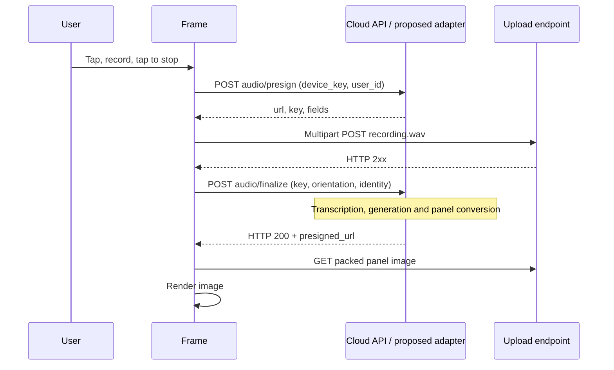

# Voice capture and generation

[Research index](README.md)

## Stock sequence



The API adapter is proposed. No local audio round trip or custom generation has
been demonstrated on the frame yet.

## Capture and timing

| Property | Recovered behavior |
| --- | --- |
| Container | RIFF/WAV, 44-byte header |
| Audio | PCM, signed 16-bit, mono, 16,000 Hz |
| Throughput | 32,000 audio bytes/second |
| Buffer capacity exposed to recorder | 2,120,000 bytes, including reserved header |
| Outer recording deadline | 6,000 ticks at 10 ms, approximately 60 seconds |
| Initial button suppression | 200 ticks, approximately two seconds |
| Completion | Single tap after suppression |
| Cancellation | More than two taps in the detected group |
| Deadline without completion | Stop recording and fail; do not upload |

Capture starts at `0x4201fed0`. `0x42010994` checks `voiceRecordingEnabled`,
starts the recording task and waits for completion. `0x42011314` handles the
button/stop/cancel outcomes. `0x420201d4` writes the WAV header in place and returns
the existing buffer. Approximately 1.92 MB of audio fits within 60 seconds; this
is a sizing estimate, not a guarantee of a successfully submitted exact-duration
recording. Silence is not the stock completion signal.

The microphone/image buffer is [shared](hardware-and-layout.md#one-psram-buffer-serves-audio-and-images).
Do not introduce image downloads during recording or reuse that memory before
audio transmission finishes. A separate WAV allocation is not implicit in the
header-generation function.

## Presign

`0x420266d8` sends:

```http
POST /api/v1/upload/audio/presign
Content-Type: application/json
```

```json
{ "device_key": "<device_key>", "user_id": "<user_id>" }
```

Illustrative response:

```json
{
  "url": "https://frame.example/audio/job-123",
  "key": "job-123/recording.wav",
  "fields": { "ticket": "<job-scoped-upload-ticket>" }
}
```

The upload routine `0x42026b9c` builds an ordinary multipart form, copying
string-valued members of `fields` and adding the file field `file`, filename
`recording.wav`. It is not an S3 SDK and does not inherently require S3 storage.
Any HTTP status from 200 through 299 is accepted for this upload.

Supply a real JSON object for `fields`. An absent field becomes an empty serialized
string and fails the later parse. `{}` is statically plausible but has not been
tested on the frame. A scoped upload ticket also gives the adapter a useful
authorization boundary.

## Finalize

`0x42027380` sends:

```http
POST /api/v1/upload/audio/finalize
Content-Type: application/json
```

```json
{
  "device_key": "<device_key>",
  "user_id": "<user_id>",
  "key": "job-123/recording.wav",
  "orientation": "portrait"
}
```

A stock-compatible result is HTTP 200 with a ready image URL:

```json
{
  "status": "completed",
  "presigned_url": "https://frame.example/panel/job-123.bin"
}
```

The parser copies `status` if supplied, otherwise defaults to `completed`. It
does not implement a job-status polling protocol. The image URL is required for
this successful path; `202` and a job ID do not queue work on the frame.
Other server fields such as `upload_public_id` do not establish firmware-level
job identity or display confirmation.

| Stage | Limit / requirement |
| --- | --- |
| Presign HTTP timeout | 30,000 ms |
| Finalize HTTP timeout | 600,000 ms |
| Outer upload task wait | Approximately 15 minutes |
| Presign/finalize JSON body read | At most 4,095 bytes |
| Copied URL | At most 1,535 bytes plus NUL |
| Copied object key | At most 255 bytes plus NUL |
| Body framing | Explicit positive `Content-Length`; avoid chunked JSON |

Hold finalize until the panel asset is ready. Align reverse-proxy timeouts with
the long request. Persist the job and deduplicate finalize calls so a retry does
not pay for another generation or create duplicate library entries.

## Cancellation and scheduled-content races

The main flow checks cancellation during upload processing and before download
and rendering. It also has an HTTP-abort mechanism and timeout cleanup. These
are device-side controls; they do not establish a durable cloud cancellation
contract. A backend worker needs its own bounded job lifetime and must handle
the client disconnecting while work is underway.

The background poll worker `0x42025aec` can interrupt an active recording when
server work is pending. The backend only learns about the voice job at presign,
after recording ends. Furthermore every poll reports `is_periodic_poll=false`.
A server-side lock beginning at presign cannot protect the earlier recording.

**Proposed firmware additions:** `recording_started`, `recording_stopped`,
`busy`, `cancel_requested`, and `render_complete` events with job/content IDs.
Use one scheduler to arbitrate routine content and voice; protect the shared
buffer at every entry point, including local HTTP uploads.

## Local speech and HA integration

The audio matches the common HA STT input format. A backend can parse the WAV,
invoke configured STT, then route the transcript to existing artwork, dashboard
rendering or image generation. An external Assist client uses WebSocket pipeline
messages and raw PCM, so the Fraimic HTTP upload still needs an adapter. See the
[Assist pipeline protocol](https://contributors.home-assistant.io/core/internals/assist-pipelines/)
and [STT entity formats](https://contributors.home-assistant.io/core/entities/stt/).

### Installed-provider check and WAV boundary

Read-only inspection of the owner's HA 2026.10.2 found Home Assistant Cloud and
Google AI STT. Both advertise 16 kHz, 16-bit mono PCM/WAV and Norwegian Bokmål;
no Wyoming/local STT integration was configured. No recording or transcription
request was sent during this check.

The authenticated HA `/api/stt/<provider>` view validates `X-Speech-Content`
metadata and passes body chunks to the provider. It does not strip a WAV header.
In this exact version, [Google AI STT](https://raw.githubusercontent.com/home-assistant/core/2026.10.2/homeassistant/components/google_generative_ai_conversation/stt.py)
collects the stream and wraps WAV-labeled input as raw PCM. Its
[conversion helper](https://raw.githubusercontent.com/home-assistant/core/2026.10.2/homeassistant/components/google_generative_ai_conversation/helpers.py)
does not detect an existing RIFF header.

A host fixture using that actual helper confirmed that passing a complete WAV
adds another header and treats the original 44 bytes as 22 extra audio samples.
Parse the Fraimic WAV, validate its PCM format and pass PCM to this provider;
do not blindly remove 44 bytes from arbitrary uploaded WAV files. This is a
container-boundary test, not a transcription quality test or proof every STT
provider has the same stream contract. See the [validation record](validation-2026-10-21.md).

Keep generated originals, transcripts, provider/job identity and edit lineage in
the HA library. A local transport can still call hosted AI; fully offline creation
also needs local STT and generation engines. Heavy inference belongs on a capable
server, not the ESP32.

A pure control command currently still needs an image result to follow the stock
success path. Async generation that sleeps while working, no-redraw success,
streaming speech recognition and automatic end-of-speech capture are proposed
protocol/firmware extensions, not existing stock features.
